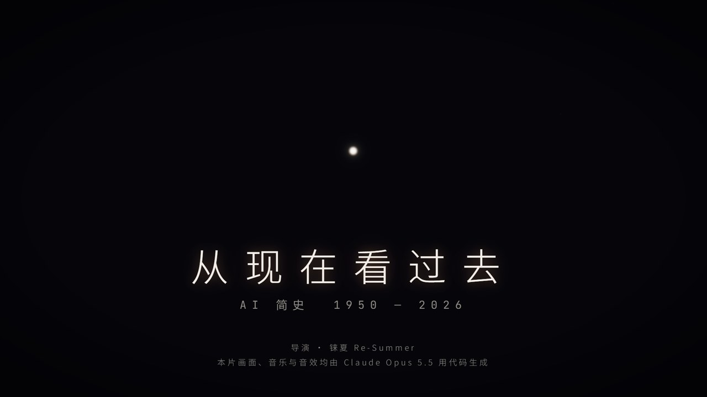
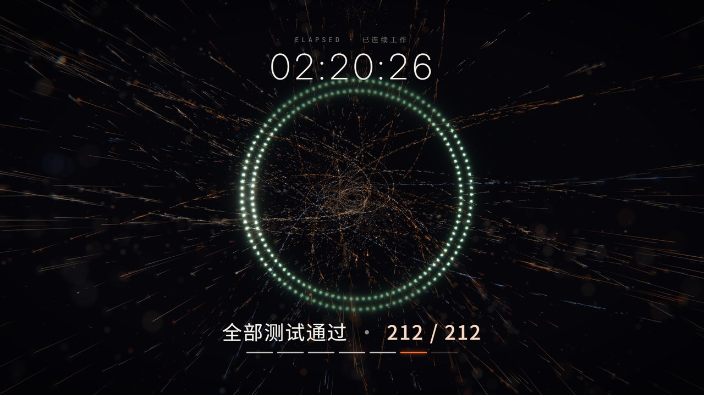
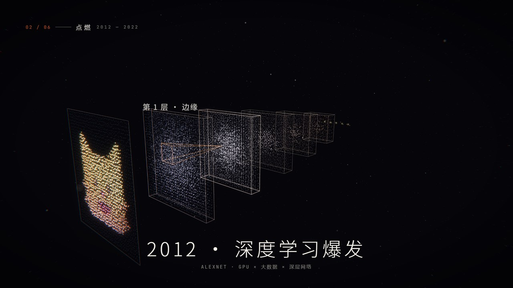
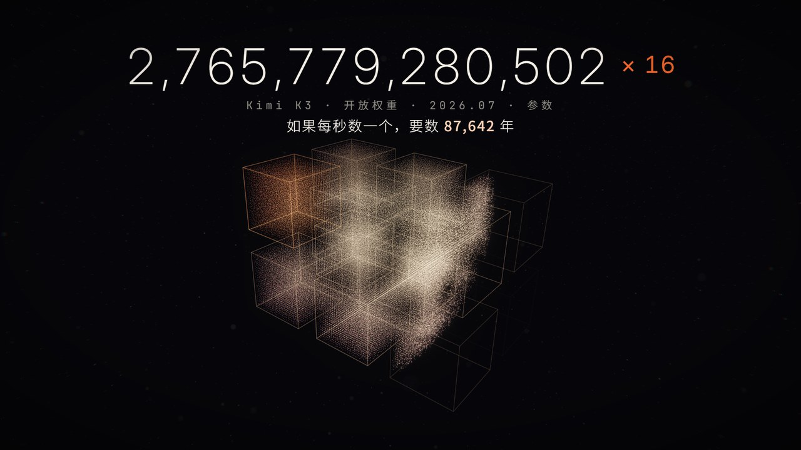
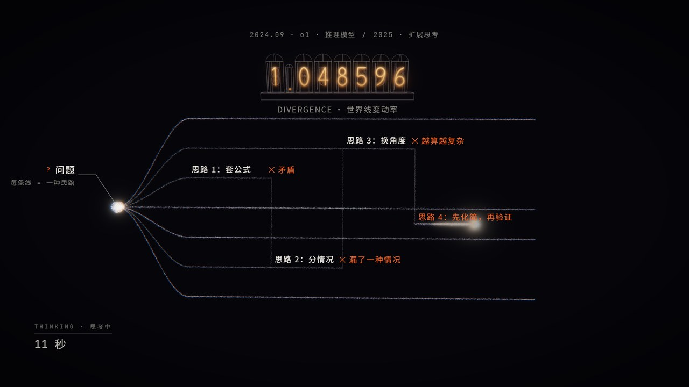
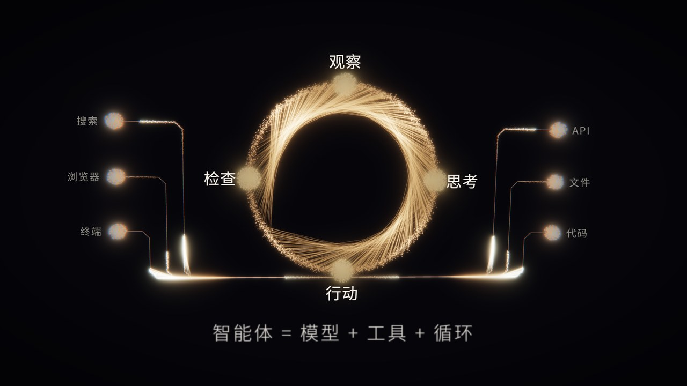
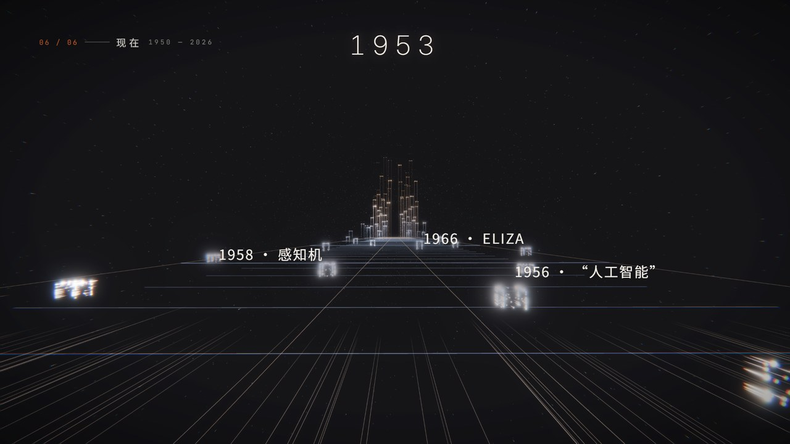

# 从现在看过去 · AI 简史

一部 6 分 29 秒、没有旁白的 AI 科普短片：从 1950 年图灵问出"机器能思考吗"，到 2026 年能独立完成一整件工作的智能体。

**画面、配乐、音效全部由代码生成**——没有用视频素材、图片素材、音乐采样或音效库。唯一借用的是系统自带的 🐱 emoji：2012 那段卷积网络里的猫，是把它采样成光点做的。这个仓库就是生成它的全部源码，按下面的步骤可以在自己电脑上把整部片重新渲染出来。

- ▶ **B 站观看**：https://www.bilibili.com/video/BV1H8av6HEYs
- ⬇ **下载原片**（1080p60，约 640 MB，未经 B 站压缩的高画质原片）：[Releases](https://github.com/Re-Summer75/ai-history-film/releases/latest)

<p align="center"></p>
<p align="center">
 
 
 
</p>

## 片子讲了什么

| 幕 | 内容 |
|---|---|
| 此刻 | 2026 年，一句话交给 AI，它自己读代码、改代码、跑测试、提交 |
| 01 一个问题 | 图灵与模仿游戏、达特茅斯会议、感知机、ELIZA、两次寒冬、反向传播 |
| 02 点燃 | 2012 深度学习爆发、ImageNet、AlphaGo 第 37 手、Transformer 与注意力、猜下一个词、规模定律、RLHF |
| 03 爆发 | ChatGPT：5 天 100 万用户 |
| 04 竞赛 | 2023–2026 的模型发布、上下文窗口、同一个问题的四个时代、推理模型、IMO / ICPC |
| 05 智能体 | 观察→思考→行动→检查的循环、自己操作电脑、MCP、Claude Code、METR 任务长度 |
| 06 现在 | 穿过 1950–2026 的时间线之城 |

片中每个数字、日期的出处见 [docs/事实核对.md](docs/事实核对.md)。

## 它是怎么做出来的

这部片是我和 Claude（Anthropic 的 AI，在 Claude Code 里）一起做的：

- **我**：提需求、看片、指出哪里不对（节奏、音效、文字、事实），决定留什么、退回哪一版。
- **Claude（Opus 5.5）**：写全部代码——粒子画面、镜头、字幕与标注、配乐、音效；逐帧渲染出片；用测量代替耳朵和眼睛自查（文字有没有互相遮挡、有没有单帧闪烁、音效和配乐的响度与对拍）。

**没有一句"神奇提示词"。** 起点只是一句话的需求，之后来回改了三十多轮，其中有两版（PPT 一样的信息图版、三维实体模型版）整版推倒重来。

- [docs/提示词.md](docs/提示词.md)：我说过的每一句话（原话，按时间）——这就是全部的"提示词"。
- [docs/开发日志.md](docs/开发日志.md)：Claude 每一轮怎么理解、改了什么、实测数据。
- [docs/音效工作说明.md](docs/音效工作说明.md)：给 Claude 的音效工作说明（长期生效的提示词）。

## 技术要点

- **画面**：three.js 写的光粒子世界——整部片是同一群约 5.6 万个光粒子在不同"形态"之间变形，一镜到底；景深、可控扩散范围的辉光、运动拖尾、色散都是自写的着色器。机能风格的标注用 HTML/SVG，动画用 GSAP 时间轴。
- **逐帧渲染**：在无头浏览器里把时间轴精确跳到"帧号 ÷ 60 秒"再截图，送进 ffmpeg，不会掉帧；30 秒一块并行渲染，中断后可以续渲。
- **时间轴**：各幕先按紧凑的时间写，再在需要让观众看清的地方插入"停留窗口"（`web2/js/warp.js`）；配乐用同一张映射表换算段落边界（`audio/timeline.py`），所以画面重音都落在拍点上。
- **配乐**：Python 从零合成（拨弦、FM、锯齿主奏、鼓组……），120 BPM、D 小调，一张贯穿全片的和弦表；每段按实测响度自动拉平（`audio/film_score.py`）。
- **音效**：`sfx/` 是基于物理建模的程序化音效库（模态合成、接触力、摩擦、气流、随机事件……）。画面在每个事件上登记"提示点"（约 430 个），逐个合成、摆上时间线，再和配乐混音母带（-16 LUFS，真峰值 -1 dBTP）。

## 自己渲染一遍

作者的环境：Windows 11、PowerShell、Python 3.12、Microsoft Edge、RTX 4060 笔记本。macOS / Linux 上没有试过（`build_film.ps1` 是 PowerShell 脚本，但里面每一步都是普通的 Python 命令）。

```powershell
python -m venv .venv
.venv\Scripts\pip install -r requirements.txt
.venv\Scripts\python -m playwright install chromium   # 没装 Edge 时需要
cd video
.\build_film.ps1                                      # 提示点 → 配乐与音效 → 逐帧渲染 → 合成
```

成片在 `video\out\从现在看过去_AI简史.mp4`。整片 23 340 帧，在作者的笔记本上 4 路并行约 15–30 分钟，配乐和混音约 4 分钟；没有可用 GPU 时浏览器会改用软件渲染，会慢很多。在 Mac / Linux 上渲染时，系统的 emoji 字体不同，2012 那段的猫会长得不一样。

在 `video` 目录下单独用的命令（先激活虚拟环境：`..\.venv\Scripts\Activate.ps1`）：

```powershell
python render.py snap 12.5 281 300.5          # 截几帧看看 → out\snaps\（带联系表）
python render.py full --from 128 --to 152     # 只渲染一段 → out\preview_128-152.mp4
python render.py cues                         # 导出音效提示点 → out\film_cues.json
cd audio; python build_audio.py --music; cd ..   # 配乐 + 音效 → out\film_mix.wav
python probe.py "await window.qaText(0, 389, 0.2)"   # 质检：文字重叠 / 出画 / 一闪而过
```

浏览器里直接看：在 `video` 目录起一个静态服务器（例如 `python -m http.server`），打开 `/web2/index.html?dev=1&t=秒数`，底部有播放和拖动条。

音效库可以单独用（在仓库根目录）：`python -m sfx list` 列出全部配方，`python -m sfx render whoosh --seeds 0 1 2` 渲染并生成分析图。

## 目录

```
video/
  web2/js/film.js       导演：形态段 + 过渡、相机、参数轨道、闪白、冲击环
  web2/js/world.js      渲染底座：景深粒子、运动拖尾、辉光、色散、文字保护
  web2/js/hud.js        机能标注：引线标注、读数、条形图、章节号
  web2/js/acts/         七幕：a0 此刻 · a1 一个问题 · a2 点燃 · a3 爆发 · a4 竞赛 · a5 智能体 · a6 现在
  web2/js/warp.js       分幕时间映射（停留窗口）
  web/                  逐帧引擎、three.js、GSAP、字体
  audio/                配乐（film_score.py、inst.py）、时间映射、音效轨与混音（build_audio.py）
  render.py             截帧 / 逐帧渲染 / 提示点导出 / 合成
  qa_text.js qa_sync.js probe.py   质检工具
sfx/                    物理建模音效库（recipes/ 下是各类音效配方）
docs/                   提示词原话、开发日志、事实核对、音效工作说明
```

## 许可

- **代码**（`video/`、`sfx/` 下的源码）：[MIT](LICENSE)。
- **影片和文档**（渲染出的成片、`docs/` 下的文档）：[CC BY-NC-SA 4.0](LICENSE-CONTENT.md)——欢迎转载和二次创作，请署名、不要商用、以相同方式共享。
- **第三方**：three.js（MIT）、GSAP（标准免费许可，许可方 Webflow）、Inter / JetBrains Mono / Noto Sans SC 字体（SIL OFL 1.1），见 [THIRD_PARTY_NOTICES.md](THIRD_PARTY_NOTICES.md)。
- 片中出现的公司、模型和产品名称归各自所有者。
